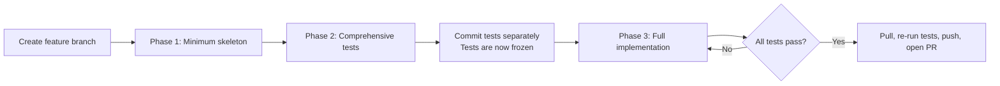

# Coding Conventions — Lunar Landing Navigator (Team 2gbram)

This document defines how code is written, tested, reviewed and merged in this project.
Every team member follows it. If a rule here blocks you, raise it with the team. Do not ignore it.

Language, framework and tooling choices (which part is written in which language, which formatter, linter and test framework are used) are defined in **`technologies.md`**, not here.

---

## 1. Golden Rules

1. **Always pull before you push.** No exceptions.
2. **One feature = one branch.** Nobody commits directly to `main`.
3. **Non-UI code follows the three-phase workflow:** minimum skeleton → comprehensive tests → full implementation, **without touching the tests**.
4. **A task is done only when all tests pass.** A partially passing test suite means the task is not finished.
5. **`main` must always build, pass all tests and be demo-ready.**
6. **All code, identifiers, comments, commit messages and docs are written in English.**
7. **Every physical quantity has an explicit unit. Every coordinate has an explicit reference frame. Every timestamp has an explicit time scale.**

---

## 2. Git Workflow

### 2.1 Branching

- `main` is protected: no direct commits and no direct pushes. Changes reach it only through Pull Requests.
- Open a separate branch for every feature, fix or task, starting from an up-to-date `main`:

```bash
git switch main
git pull
git switch -c feature/sun-earth-visibility
```

- Branch naming: `<type>/<short-kebab-case-description>`

| Prefix      | Use for                                  |
|-------------|------------------------------------------|
| `feature/`  | New functionality                        |
| `fix/`      | Bug fixes                                |
| `ui/`       | User interface work                      |
| `docs/`     | Documentation only                       |
| `chore/`    | Build, config, dependencies, tooling     |
| `refactor/` | Behavior-preserving restructuring        |

- One person owns a branch. If two people need to work on the same feature, split it into smaller branches.
- Keep branches short-lived. Merge small, working pieces often instead of one huge branch at the end.
- Delete the branch after it is merged.

### 2.2 Pull Before Push (Mandatory)

Before **every** push:

```bash
git pull                  # sync your branch with its remote copy
git pull origin main      # bring the latest main into your branch
# resolve conflicts if any
# run the FULL test suite and make sure everything passes
git push
```

Rules:

- Never push without pulling first.
- Never push after resolving conflicts without re-running all tests.
- **Force pushing is forbidden** (`--force`, `-f`). If you think you need it, ask the team first.
- Never rewrite history that has already been pushed (no `rebase`, `reset` or `commit --amend` on pushed commits).

### 2.3 Commits

Use the [Conventional Commits](https://www.conventionalcommits.org/) format:

```
<type>(<scope>): <short imperative summary>
```

Examples:

```
feat(visibility): add skeleton for sun elevation calculation
test(visibility): add comprehensive tests for sun elevation
feat(visibility): implement sun elevation calculation
fix(terrain): handle missing DEM tiles at map edges
docs(readme): add data download instructions
```

Allowed types: `feat`, `test`, `fix`, `refactor`, `docs`, `chore`, `perf`, `style`, `ui`.

- Summary line: imperative mood ("add", not "added"), max ~72 characters, no trailing period.
- One logical change per commit. Do not mix unrelated changes.
- Never commit code that does not build.
- Never commit generated files, local configs, large datasets or secrets.

### 2.4 Pull Requests

- Every PR needs **at least one approval from another team member** before merging.
- The author does not merge their own PR without that approval.
- All tests must pass before merging.
- Use **squash merge** so `main` stays clean (one commit per feature).
- Keep PRs small and focused. A reviewer should be able to understand a PR in about 15 minutes.
- The PR description must include:
  - What the change does and why
  - The related task or feature
  - **The SHA of the test commit** (for non-UI work, see Section 3)
  - How it was verified
  - Any assumptions or known limitations

---

## 3. Development Workflow for Non-UI Code (Test-First)

All code **except the user interface** (calculations, data processing, algorithms, backend, APIs, simulations) is developed in three strict phases.



### Phase 1 — Minimum Skeleton

Write only what is needed for tests to compile and import:

- Public functions, classes, method signatures, data types and module structure.
- Function bodies are stubs (e.g. raise a "not implemented" error).
- No real logic.

Commit: `feat(<scope>): add skeleton for <feature>`

### Phase 2 — Comprehensive Tests

Write the full test suite against the skeleton. At this point, the tests are expected to fail.

Tests must cover:

- **Normal cases:** typical, expected inputs.
- **Edge and boundary cases:** zero, minimum and maximum values, empty inputs, polar coordinates (latitude ±90°), longitude wrap-around (±180°), date boundaries, the Sun or Earth exactly on the horizon.
- **Invalid input:** wrong types, out-of-range values, missing data. Verify that the correct error is raised.
- **Reference values:** compare scientific results against authoritative sources (e.g. NASA/JPL ephemerides, published papers, official datasets). Document the source in the test.
- **Numerical tolerance:** compare floating-point results with an explicit, justified tolerance. Never use exact equality.
- **Determinism:** randomized code (e.g. Monte Carlo) must be tested with a fixed seed and must produce identical results on every run.
- **Physical sanity:** results must respect physical constraints (e.g. fuel never negative, elevation angle within [-90°, 90°], probabilities within [0, 1]).

Commit **only the tests**: `test(<scope>): add comprehensive tests for <feature>`

**From this commit on, the tests are frozen.**

### Phase 3 — Full Implementation

- Implement the real logic until **every** test passes.
- **Test files must not be modified in this phase. No editing, no deleting, no skipping, no lowering tolerances, no marking tests as expected failures.**
- Do not distort or hard-code the implementation just to make tests pass. The code must be genuinely correct.

Commit: `feat(<scope>): implement <feature>`

### Test Freeze Verification

The reviewer verifies that the tests were not changed after the test commit:

```bash
git diff <test-commit-sha> HEAD -- <test-directory>
```

The output must be empty. If it is not, the PR is rejected.

### If a Frozen Test Is Genuinely Wrong

Sometimes a test itself is incorrect (wrong reference value, wrong expectation). In that case:

1. Stop implementing.
2. Explain the problem to the team, with evidence.
3. Get approval from another team member.
4. Fix the test in a **separate** `test(<scope>): ...` commit that explains why it was wrong.
5. That commit becomes the new frozen baseline. Report its SHA in the PR.

"The test is hard to pass" is never a valid reason to change a test.

### Definition of Done (Non-UI)

- [ ] Skeleton, test and implementation commits exist separately
- [ ] Tests are unchanged since the test commit (or changed only through the approved process above)
- [ ] **100% of tests pass**, including the full project suite, not only the new tests
- [ ] No linter or formatter errors
- [ ] Assumptions and data sources are documented
- [ ] PR approved by at least one teammate

---

## 4. User Interface Code

- UI code is **exempt** from the three-phase workflow.
- **The UI contains no business logic.** All calculations, decisions and data transformations live in non-UI modules (which are tested). The UI only displays data and forwards user input.
- If you find yourself writing calculation logic inside a UI component, move it into a tested module.
- UI work still uses feature branches, pull-before-push and PR review.
- Verify UI changes manually before opening a PR and describe what you checked in the PR.

---

## 5. Code Style

### 5.1 General

- Follow the formatter and linter defined in `technologies.md`. Formatting is not up for debate; the tool decides.
- Simple over clever. Explicit over implicit.
- A function does one thing. If you need "and" to describe it, split it.
- Prefer pure functions for calculations: same input → same output, no hidden state.
- No dead code, no commented-out code. Git keeps history.
- No unused imports, variables or functions.
- No premature abstraction. Do not create interfaces, factories or managers for hypothetical future needs.
- Do not add dependencies without team agreement. Every new dependency is recorded in `technologies.md`.

### 5.2 Naming

- Names are descriptive English words. Avoid abbreviations unless they are standard in the domain (`dem`, `utc`, `lola`, `lro`).
- Boolean names read as questions: `is_visible`, `has_line_of_sight`, `can_land`.
- Functions use verbs: `compute_sun_elevation`, `load_dem_tile`.
- Use the naming case conventions of the language in use (defined in `technologies.md`).

### 5.3 Units, Frames and Time (Critical)

Mistakes here silently produce wrong results. These rules are mandatory.

- **Every physical quantity carries its unit in its name**, unless the type system enforces units:
  - `altitude_m`, `velocity_mps`, `mass_kg`, `thrust_n`, `burn_duration_s`, `delta_v_mps`
  - `elevation_deg` vs. `elevation_rad`. Never just `elevation`.
- **Angles:** use radians internally for calculations. Convert to degrees only at input/output boundaries (UI, reports, files), and name them accordingly.
- **Coordinates:** always state the reference frame and the body (e.g. Moon-fixed, selenographic latitude/longitude, inertial frame). Document it in function signatures and docstrings.
- **Time:** never use naive or local timestamps. Always state the time scale (UTC, TDB, etc.) and convert explicitly.
- **No magic numbers.** All physical constants (lunar radius, gravitational parameter, etc.) live in one dedicated constants module, with units and source:

```text
MOON_MEAN_RADIUS_M = 1_737_400.0   # Source: <reference>
```

### 5.4 Comments and Documentation

- Code explains *what*. Comments explain *why*. Comment only non-obvious logic, formulas and decisions.
- Every formula or algorithm taken from a paper, dataset or document includes a reference to its source.
- Every public function documents: purpose, parameters (with units and frames), return value (with units), and the errors it can raise.
- `TODO` comments must include an owner and a reason: `TODO(emre): handle eclipse periods, see task #12`.

---

## 6. Error Handling and Validation

- **Fail loudly.** Never silently swallow errors. Never use catch-all error handling that hides failures.
- Validate inputs at module boundaries (API endpoints, file loaders, user input). Internal code can then rely on valid data.
- Error messages must be specific and actionable: include the invalid value and the expected range.
- Never return a fake or default value (e.g. `0`) to hide a failed calculation.
- Missing or corrupt data must be reported explicitly, not interpolated or guessed without being flagged.

---

## 7. Scientific Correctness and Assumptions

This is a decision-support tool built on real NASA data. Its results must be traceable.

- Every model assumption (spacecraft mass, engine specific impulse, sensor error, terrain resolution, etc.) is written down with its source or justification in a dedicated assumptions document.
- Values that are not publicly available must be clearly labeled as **reference values** or **assumptions** in code, outputs and reports.
- Never present a guessed number as a measured or official one.
- Simplified models are allowed, but the simplification must be documented (e.g. "spherical Moon", "no terrain occlusion beyond N km").
- Results shown to the user should, where meaningful, indicate the uncertainty or limitations behind them.

---

## 8. Data Management

- **Large datasets (DEM tiles, LOLA/LRO products, ephemeris kernels) are never committed to Git.**
- Data is obtained through download scripts that are committed. Each script records:
  - The source URL
  - The product or version identifier
  - A checksum to verify integrity
- Raw downloaded data is never modified in place. Processed data is written separately.
- Data directories are listed in `.gitignore`.
- Small fixture files used by tests may be committed if they are reasonably small and their origin is documented.

---

## 9. Reproducibility

- Dependency versions are pinned (lock files are committed).
- Any randomness accepts an explicit seed. Default seeds are fixed, not time-based.
- Anyone on the team must be able to clone the repo, follow the README and get the same results.
- The README must always contain up-to-date setup, data download, run and test instructions.

---

## 10. Security and Secrets

- **Never commit secrets**: API keys, tokens, passwords, credentials.
- Use environment variables. Commit a `.env.example` file with placeholder values only. `.env` is in `.gitignore`.
- If a secret is committed by accident, tell the team immediately and revoke/rotate it. Deleting the commit is not enough.

---

## 11. Code Review Checklist

The reviewer checks every PR against this list:

- [ ] Branch is based on an up-to-date `main` and has no conflicts
- [ ] Commit messages follow the convention
- [ ] For non-UI code: skeleton → tests → implementation commits exist
- [ ] For non-UI code: tests are unchanged since the test commit (`git diff` is empty)
- [ ] All tests pass
- [ ] Tests are comprehensive: normal, edge, invalid input, reference values, tolerance, determinism
- [ ] No business logic inside UI code
- [ ] Units, frames and time scales are explicit
- [ ] No magic numbers; constants have units and sources
- [ ] No dead code, commented-out code or unused imports
- [ ] No secrets, large data files or generated files
- [ ] Assumptions and data sources are documented
- [ ] Code is readable without the author explaining it

Review comments are about the code, not the person. If you disagree, explain the technical reason.

---

## 12. Summary of Forbidden Actions

- Pushing without pulling first
- Committing or pushing directly to `main`
- Force pushing or rewriting pushed history
- Modifying, deleting, skipping or weakening tests after the test commit
- Merging with any failing test
- Merging without another teammate's approval
- Committing secrets or large datasets
- Putting calculation logic inside UI code
- Using physical quantities without explicit units
- Presenting assumed values as real data