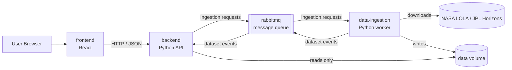

# Technologies

This document defines which technology is used in which part of **Lunar Landing Navigator**.
Any change to this file must be agreed on by the whole team before it is merged.

## Release scope

The first release follows [the MVP roadmap](mvp-roadmap.md). JPL Horizons is the selected source for Sun and Earth positions. The ingestion worker retrieves and caches responses, and the backend computes terrain visibility from those cached results. Trajectory, fuel, risk and rover capabilities belong to later releases.

## Core Rules

1. **Frontend (user interface) is written in React.**
2. **Everything else is written in Python.** This includes the API, data ingestion, data processing, astronomical calculations, terrain analysis, trajectory and fuel calculations, risk analysis and tests for these parts.
3. **The whole project runs with Docker Compose.** No part of the project requires a manual local install other than Docker and Docker Compose.
4. **Data ingestion is a separate service.** It never runs inside the backend process, and it talks to the backend only through an asynchronous message queue.
5. Do not add a new language, framework or major dependency without updating this file first.

## Architecture Overview



## Frontend

| Area | Technology |
|---|---|
| UI library | React |
| Language | TypeScript |
| Build tool / dev server | Vite |
| 3D Moon map and trajectory view | Three.js via React Three Fiber |
| Charts (visibility timelines, fuel, landing time) | Recharts |
| Testing | Vitest + React Testing Library |
| Package manager | npm |

Responsibilities:
- Rendering the 3D Moon map, risk map and landing trajectories.
- Showing Sun/Earth visibility timelines and comparison charts.
- Collecting user input (site, date, spacecraft parameters, mission priorities).
- **No scientific calculation is done in the frontend.** All calculations come from the backend API.

## Backend

| Area | Technology |
|---|---|
| Language | Python 3.12 |
| API framework | FastAPI |
| ASGI server | Uvicorn |
| Data validation / schemas | Pydantic |
| Message queue client | aio-pika |
| Numerical computation | NumPy, SciPy |
| Sun and Earth positions | JPL Horizons observer ephemerides, fetched by data-ingestion |
| Lunar terrain data (DEM) reading | Rasterio (GDAL) |
| Testing | pytest |
| Linting / formatting | Ruff |
| Dependency management | `requirements.txt` with pinned versions |

Responsibilities:
- Reading processed terrain and ephemeris data from the shared data volume.
- Reading cached Horizons Sun/Earth positions and computing terrain visibility and time windows.
- Trajectory, fuel, risk (Monte Carlo) and landing site recommendation calculations.
- Exposing all results through a REST API.
- Publishing ingestion requests and consuming dataset events from the message queue.
- **The backend never downloads data from external sources.**

## Data Ingestion Service

| Area | Technology |
|---|---|
| Language | Python 3.12 |
| Message queue client | aio-pika |
| HTTP client (downloads) | HTTPX |
| Message schemas | Pydantic |
| DEM processing | Rasterio (GDAL), NumPy |
| Testing | pytest |
| Linting / formatting | Ruff |
| Dependency management | `requirements.txt` with pinned versions |

Responsibilities:
- Downloading LRO/LOLA terrain data and querying JPL Horizons for requested sites and UTC intervals.
- Caching raw Horizons responses and normalized time series, with query parameters, provenance and explicit pending/ready/failed states.
- Verifying downloaded files (size / checksum when available).
- Preprocessing raw data into the formats the backend uses (e.g. cropping, reprojecting, deriving slope maps).
- Writing processed data to the shared data volume.
- Consuming ingestion requests and publishing dataset events (ready / failed) to the message queue.

## Message Queue

| Area | Technology |
|---|---|
| Broker | RabbitMQ |
| Client library (all Python services) | aio-pika |
| Message format | JSON, validated with Pydantic models |

Rules:
- Messages carry **references and metadata only** (dataset id, file path in the data volume, status, error message). Large data files are never sent through the queue.
- Message schemas are defined as Pydantic models and shared by the backend and data-ingestion service so both sides use the same contract.
- Messages must be durable and acknowledged only after they are fully processed, so no work is lost if a service restarts.
- Ingestion requests must be idempotent: processing the same request twice must not corrupt or duplicate data.

## Data Sources

| Data | Source |
|---|---|
| Lunar elevation and slope (DEM) | NASA LRO LOLA (PDS) |
| Sun/Earth observer positions and frame metadata | NASA/JPL Horizons observer ephemerides |

Data files are **not committed to Git**. They are downloaded by the data-ingestion service and stored in a shared Docker volume.

## Docker Compose

The project is started with a single command:

```bash
docker compose up --build
```

| Service | Description | Port |
|---|---|---|
| `frontend` | React app served by the Vite dev server | `5173` |
| `backend` | FastAPI application | `8000` |
| `data-ingestion` | Python worker that downloads and preprocesses NASA data | — |
| `rabbitmq` | RabbitMQ broker with management UI | `5672`, `15672` |

Rules:
- Each application service has its own `Dockerfile` in its own directory (`frontend/`, `backend/`, `data-ingestion/`). RabbitMQ uses the official image.
- The data volume is mounted **read-write** in `data-ingestion` and **read-only** in `backend`.
- `backend` and `data-ingestion` wait for the `rabbitmq` health check before starting.
- Source code is mounted as a volume in development so changes reload without rebuilding.
- Configuration (including RabbitMQ credentials) is passed via environment variables in a `.env` file; `.env.example` is committed, `.env` is not.
- Tests are run inside containers:
  - Backend: `docker compose run --rm backend pytest`
  - Data ingestion: `docker compose run --rm data-ingestion pytest`
  - Frontend: `docker compose run --rm frontend npm test`

## Repository Layout

```text
.
├── docker-compose.yml
├── .env.example
├── frontend/
│   ├── Dockerfile
│   └── src/
├── backend/
│   ├── Dockerfile
│   ├── requirements.txt
│   ├── app/
│   └── tests/
├── data-ingestion/
│   ├── Dockerfile
│   ├── requirements.txt
│   ├── app/
│   └── tests/
└── data/            # not committed
```
## Step 0 implementation status

Shared Pydantic input contracts live in `shared/contracts.py`, mounted into both Python services. The backend exposes process liveness and the worker opens a broker connection. Message schemas and ingestion consumers follow in Step 1. Scientific libraries, React Three Fiber and Recharts will be installed with the features that use them. Direct dependency versions are pinned. The frontend lockfile and container checks were verified locally on 2026-11-14; Python transitive dependency locks and clean-clone installation also passed; see python-dependencies.md and clean-install-verification.md. Vitest uses jsdom for DOM rendering tests.

### Frontend audit remediation

Vite 7.3.8 and Vitest 4.1.12 are pinned in package.json. The earlier Vitest 3.2.7 selection still triggered three npm audit findings. Updating with npm 11 worked around an npm 10.9.4 resolver error (`edgesOut`). The regenerated lockfile then passed npm ci with the image's original npm version, npm audit (zero vulnerabilities), the existing frontend test and the production build on 2026-11-14. No test files were changed.
