# Lunar Landing Navigator — User Scenarios

> **Team:** 2gbram — NASA Space Apps Challenge
> **Challenge:** Lunar Landing Site Navigator
> **Purpose of this document:** Define who uses the system, what they want to achieve, and how each module supports them. Every scenario maps to one or more system modules and has testable acceptance criteria.

> **Note on thresholds:** Numeric values in this document (e.g. "72 hours of continuous sunlight", "slope below 10°") are example defaults. The team should replace them with documented assumptions.

---

## 1. Personas

| ID | Persona | Description | Main need |
|----|---------|-------------|-----------|
| P1 | **Mission Planner** | Engineer evaluating candidate landing sites and dates | Quantitative, comparable, exportable results |
| P2 | **Science Team Member** | Researcher targeting a specific scientific feature | Sites close to science targets that are still safe and operable |
| P3 | **Educator** | Teacher or lecturer explaining lunar south pole conditions | Clear visuals and guided demonstrations |
| P4 | **Public User** | Space enthusiast with little technical background | Simple answers in plain language |

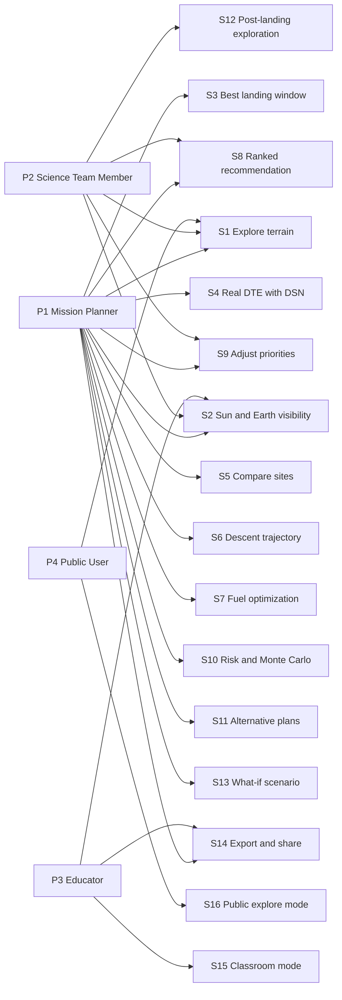

---

The scenarios below describe the full product roadmap. Release assignments in section 4 determine which portions belong to the first MVP.

## 2. Modules

| ID | Module |
|----|--------|
| M1 | 3D Lunar Map with Real NASA Data |
| M2 | Sun and Earth Visibility Analysis |
| M3 | Landing Trajectory Calculation |
| M4 | Fuel Consumption Optimization |
| M5 | Smart Landing Site Recommendation |
| M6 | Risk and Uncertainty Analysis |
| M7 | Alternative Landing Plans |
| M8 | Post-Landing Mission Planning |
| M9 | Dynamic Scenario Simulation |
| M10 | Interactive Mission Control Dashboard |

---

## 3. Scenario Index

| ID | Scenario | Persona | Modules |
|----|----------|---------|---------|
| S1 | Explore terrain and inspect a location | P1, P2, P4 | M1 |
| S2 | Analyze Sun and Earth visibility at a point | P1, P2, P3 | M1, M2 |
| S3 | Find the best landing window | P1 | M2 |
| S4 | Verify real direct-to-Earth communication | P1 | M2 |
| S5 | Compare candidate landing sites | P1 | M1, M2, M10 |
| S6 | Compute a descent trajectory | P1 | M3 |
| S7 | Optimize fuel consumption across routes | P1 | M3, M4 |
| S8 | Get a ranked, explained recommendation | P1, P2 | M5 |
| S9 | Adjust mission priorities | P1, P2 | M5 |
| S10 | Run risk and Monte Carlo analysis | P1 | M6 |
| S11 | Prepare alternative landing plans | P1 | M7 |
| S12 | Plan post-landing exploration | P2 | M8 |
| S13 | Run a what-if scenario | P1 | M9 |
| S14 | Export and share results | P1, P3 | M10 |
| S15 | Classroom demonstration mode | P3 | M1, M2 |
| S16 | Public explore mode | P4 | M1, M2 |

---

## 4. Build Order

The implementation checklist and release acceptance criteria live in [mvp-roadmap.md](mvp-roadmap.md). Complete and demonstrate the MVP before proceeding through the later releases.

| Release | Scenarios | Delivered scope |
|---|---|---|
| MVP | S1, S2, S5, S13, S15, S16 (scoped below) | Site selection, UTC date changes, terrain horizon, Sun/Earth paths, timelines, metrics and accessible comparison |
| R1 | S3, S14; full S15 | Window search, CSV/PNG/report export, reproducible sharing and guided teaching presets |
| R2 | S4 | Ground-station visibility and documented communication assumptions |
| R3 | S8, S9 (terrain and visibility criteria) | Explained ranking and adjustable priorities |
| R4 | S6 | Descent trajectories and vehicle limits |
| R5 | S7; extend S8/S9 | Fuel optimization and fuel-aware ranking |
| R6 | S10 | Risk and uncertainty analysis |
| R7 | S11 | Reachable backup landing plans |
| R8 | S12 | Post-landing exploration routes |
| R9 | Full S13 | Vehicle and mission parameter simulation |
| R10 | Optional experiment | Hybrid quantum optimization evaluated against a classical baseline |

The MVP portions have the following boundaries. Their detailed release criteria are in the roadmap.

- S1 delivers a sourced site list, coordinate entry, map selection, elevation and coverage feedback. Hazard classification and hazard distance follow with R3.
- S2 delivers terrain-relative positions, partial solar disk handling and visibility windows using cached Horizons data.
- S5 compares at least two site/date scenarios with aligned settings and explicit differences.
- S13 supports a baseline and a changed site or date, including a launch-delay example. Vehicle parameters follow with R9.
- S15/S16 deliver one accessible preset, a horizon/sky view, time playback and plain-language explanations. Dedicated classroom narratives follow with R1.

---

## 5. Scenarios

### S1 — Explore Terrain and Inspect a Location

**Release assignment — MVP subset; hazard analysis in R3**

- **Actor:** P1, P2, P4
- **Goal:** Inspect the lunar south pole terrain and evaluate the safety of a specific location.
- **Preconditions:** LOLA DEM data and derived slope data are loaded.

**Main flow**
1. The user opens the 3D lunar map.
2. The user pans, zooms, and rotates the view.
3. The user toggles terrain layers: elevation, slope, and hazard.
4. The user clicks a location or enters coordinates.
5. The system shows elevation, slope, distance to the nearest hazard, and a safety classification.

**Alternative flows**
- Coordinates outside the data coverage: the system shows an error and suggests the nearest valid area.

**Acceptance criteria**
- Clicking a location returns terrain information within 2 seconds.
- Safe and hazardous zones are visually distinguishable.

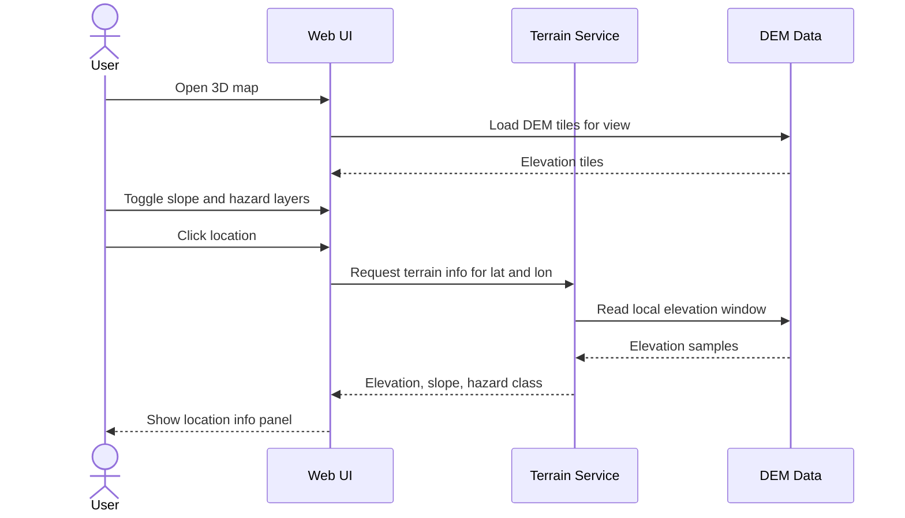

---

### S2 — Analyze Sun and Earth Visibility at a Point

**Release assignment — MVP**

- **Actor:** P1, P2, P3
- **Goal:** See when the Sun and Earth are above the local terrain horizon during a date range.
- **Preconditions:** A location is selected. Cached JPL Horizons observer ephemerides are available.

**Main flow**
1. The user selects a location and a date range.
2. The system computes a 360° horizon mask from the DEM.
3. The system computes Sun and Earth azimuth and elevation over time.
4. The system overlays the Sun and Earth paths on the horizon profile.
5. The system shows a timeline with sunlight, shadow, and Earth visibility intervals.

**Output**
- Illumination percentage, longest shadow period, total Earth visibility time, and a horizon plot with sky paths.

**Acceptance criteria**
- The horizon mask accounts for surrounding terrain, not only the local slope.
- Partial solar disk visibility is handled, since the Sun's apparent diameter is about 0.5°.
- The user can answer "Is this point suitable on this date?" in under 1 minute.

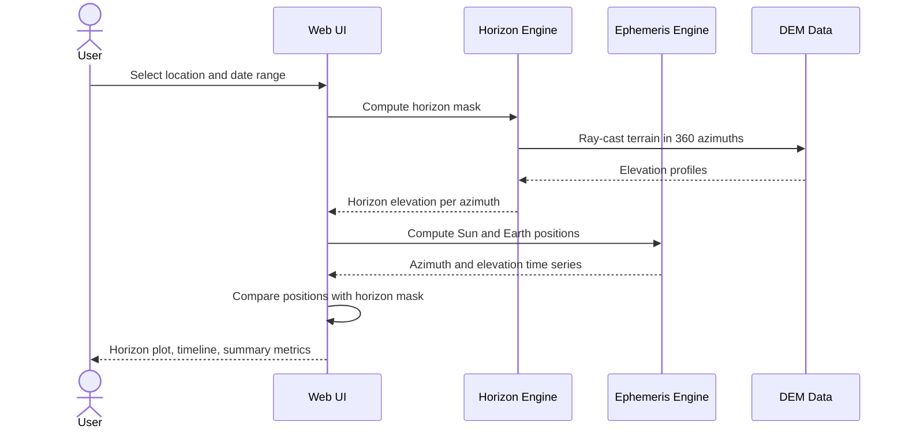

---

### S3 — Find the Best Landing Window

**Release assignment — R1**

- **Actor:** P1
- **Goal:** Find landing dates that satisfy power and communication constraints for a fixed location.
- **Preconditions:** A location is selected.

**Main flow**
1. The user enters constraints, for example at least 72 hours of continuous sunlight and at least 6 hours of Earth visibility after landing.
2. The user sets a search range.
3. The system scans the range and finds windows that satisfy all constraints.
4. The system lists the windows sorted by quality.
5. The user selects a window to open its visibility view (S2).

**Alternative flows**
- No window satisfies the constraints: the system shows the closest windows and which constraint each one fails.

**Acceptance criteria**
- Every listed window satisfies every constraint.
- Each window shows the start time, duration, and margin for each constraint.

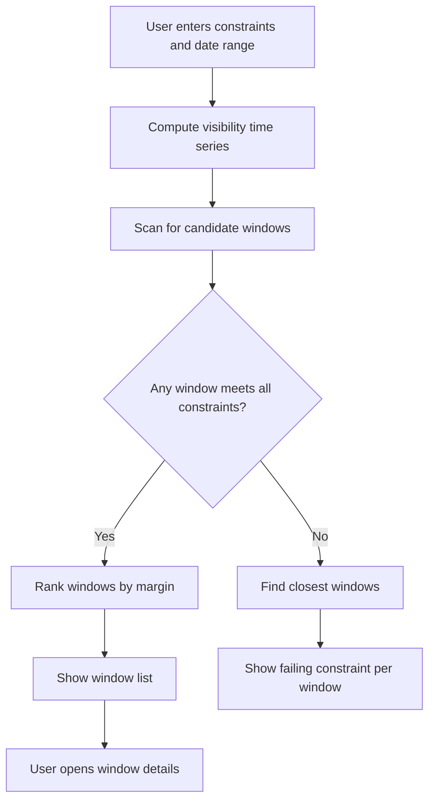

---

### S4 — Verify Real Direct-to-Earth Communication

**Release assignment — R2**

- **Actor:** P1
- **Goal:** Find when direct-to-Earth communication is actually possible. This requires Earth to be above the local horizon and at least one ground station to see the Moon.
- **Preconditions:** Earth visibility is computed (S2). Ground station locations (DSN Goldstone, Madrid, Canberra) are configured.

**Main flow**
1. The user opens the communication tab.
2. The system computes the Moon's elevation from each ground station.
3. The system intersects the station visibility with the Earth visibility at the landing site.
4. The system shows one band per station plus a combined communication band.

**Acceptance criteria**
- The communication window is shown only when both conditions are true.
- The user can see which station covers each window.

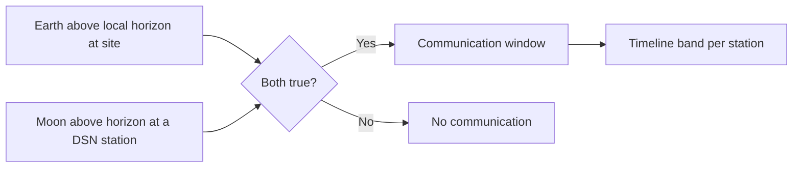

---

### S5 — Compare Candidate Landing Sites

**Release assignment — MVP**

- **Actor:** P1
- **Goal:** Decide which of several candidate sites is the most suitable.
- **Preconditions:** At least two locations are saved as candidates.

**Main flow**
1. The user adds 2 to 4 sites to the comparison list.
2. The user selects a common date range.
3. The system computes terrain and visibility metrics for every site.
4. The system shows a side-by-side table and overlaid timelines.
5. The system highlights the best value in each metric.

**Output**
- Comparison table with illumination, communication time, longest shadow, slope, and hazard distance.

**Acceptance criteria**
- All sites use the same date range and the same computation settings.
- The table can be sorted by any metric.

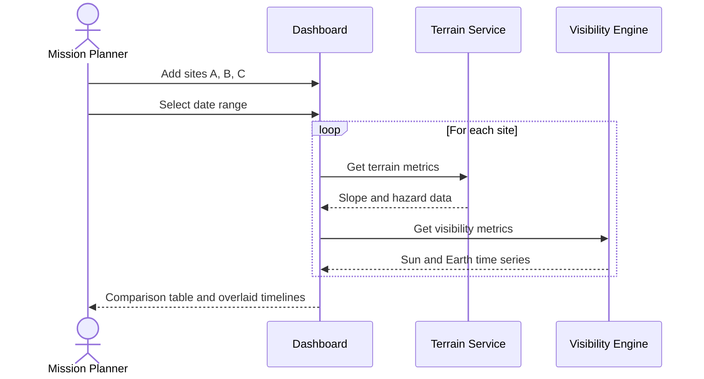

---

### S6 — Compute a Descent Trajectory

**Release assignment — R4**

- **Actor:** P1
- **Goal:** Compute a descent route from lunar orbit to the selected landing site.
- **Preconditions:** A landing site is selected. A spacecraft profile is defined (mass, thrust, specific impulse, initial orbit).

**Main flow**
1. The user selects a spacecraft profile or enters custom parameters.
2. The user defines the initial orbit (altitude, inclination).
3. The system computes the deorbit, braking, approach, and terminal descent phases.
4. The system shows the trajectory in 3D together with the timing of each phase.
5. The system reports total descent time, delta-v per phase, and the required maneuvers.

**Alternative flows**
- The site is unreachable from the given orbit within the vehicle limits: the system reports the limiting factor, such as a large plane change.

**Acceptance criteria**
- All physical assumptions are visible to the user, including the gravity model and the engine model.
- The trajectory ends at the selected site within the stated tolerance.

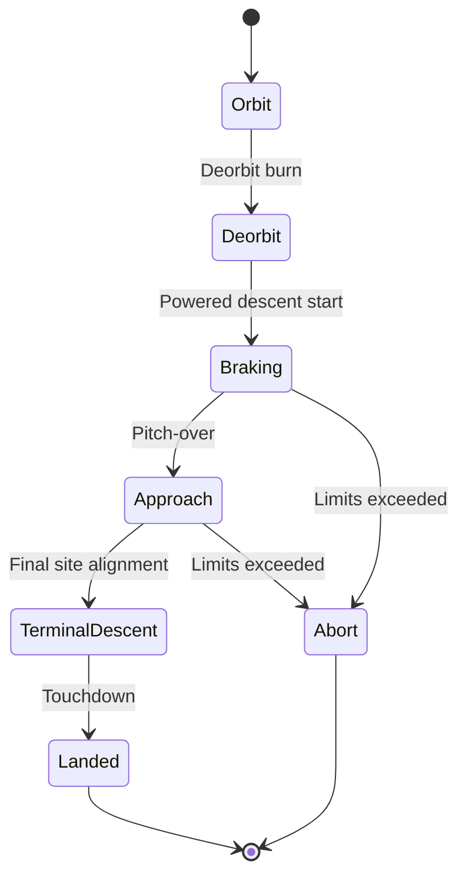

---

### S7 — Optimize Fuel Consumption Across Routes

**Release assignment — R5**

- **Actor:** P1
- **Goal:** Find feasible routes that use less fuel while keeping safety margins.
- **Preconditions:** A spacecraft profile with fuel capacity and a reserve requirement is defined.

**Main flow**
1. The user requests route optimization for one or more sites.
2. The system generates several feasible trajectories (S6) by varying the parameters.
3. The system estimates fuel use for each trajectory.
4. The system discards routes that violate the fuel reserve or engine limits.
5. The system shows the trade-off between fuel use and safety margin.

**Output**
- Route list with fuel used, remaining reserve, delta-v, and safety score. Trade-off chart.

**Acceptance criteria**
- No listed route violates the fuel reserve requirement.
- The user can see why each discarded route was rejected.

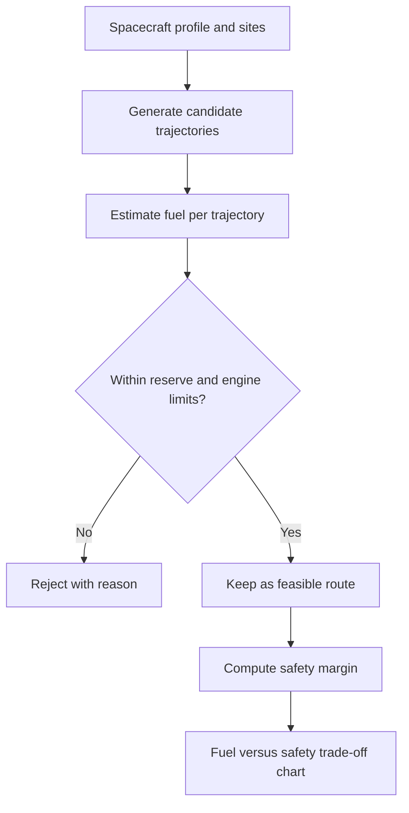

---

### S8 — Get a Ranked, Explained Recommendation

**Release assignment — R3; fuel and trajectory criteria added after R5**

- **Actor:** P1, P2
- **Goal:** Get a ranked list of landing sites with a clear explanation for each ranking.
- **Preconditions:** A search area, a date range, and mission goals are defined.

**Main flow**
1. The user defines the search area and optional science targets.
2. The system removes sites that fail hard constraints (slope, hazard, reachability).
3. The system scores the remaining sites on terrain safety, fuel, communication, sunlight, and science value.
4. The system ranks the sites and generates an explanation for each one.
5. The user opens a site to see its score breakdown.

**Acceptance criteria**
- Every eliminated site shows which hard constraint it failed.
- Every ranked site shows its score contribution per criterion.

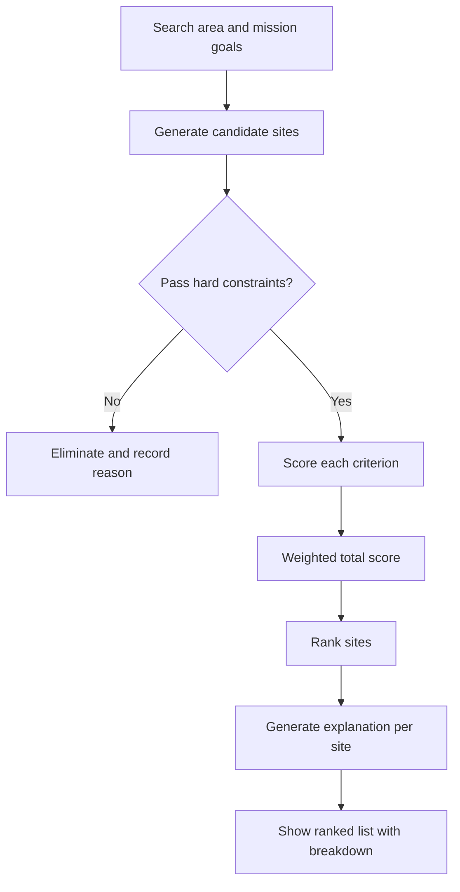

---

### S9 — Adjust Mission Priorities

**Release assignment — R3; fuel criterion added after R5**

- **Actor:** P1, P2
- **Goal:** See how changing the importance of each criterion changes the recommendation.
- **Preconditions:** A ranked recommendation exists (S8).

**Main flow**
1. The user moves weight sliders, for example energy, communication, fuel, safety, and science.
2. The system recomputes the scores and the ranking.
3. The system highlights the sites whose rank changed and explains why.

**Acceptance criteria**
- The ranking updates without recomputing the visibility or trajectory data.
- The system can show the previous and new rankings side by side.

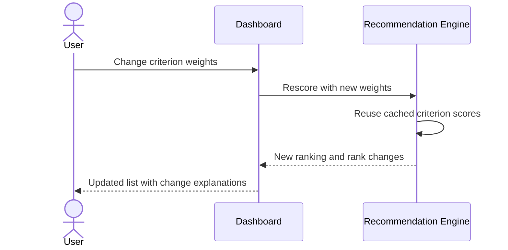

---

### S10 — Run Risk and Monte Carlo Analysis

**Release assignment — R6**

- **Actor:** P1
- **Goal:** Test how robust a landing plan is under uncertainty.
- **Preconditions:** A landing plan exists (site, date, and trajectory).

**Main flow**
1. The user defines the uncertainty ranges: sensor error, engine performance variation, landing position dispersion, and DEM resolution error.
2. The user sets the number of simulation runs.
3. The system runs a Monte Carlo simulation of the plan.
4. The system shows the landing dispersion ellipse, the success rate, and the fuel use distribution.
5. The system reports which uncertainty contributes the most to failure.

**Acceptance criteria**
- Results show a distribution, not a single value.
- The landing dispersion is drawn on the terrain map, together with the hazards inside it.

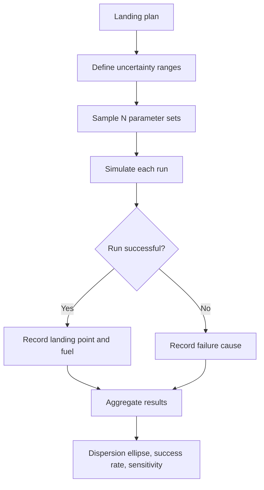

---

### S11 — Prepare Alternative Landing Plans

**Release assignment — R7**

- **Actor:** P1
- **Goal:** Have backup sites and routes ready in case the primary plan fails.
- **Preconditions:** A primary plan exists.

**Main flow**
1. The user requests alternative plans for the primary plan.
2. The system finds nearby sites that pass the hard constraints.
3. The system checks whether each alternative is reachable with the remaining fuel and maneuver capability.
4. The system compares the alternatives on safety, time, and fuel.
5. The user marks one or more alternatives as backups.

**Acceptance criteria**
- Every alternative is reachable under the stated vehicle limits.
- The comparison uses the same metrics as the primary plan.

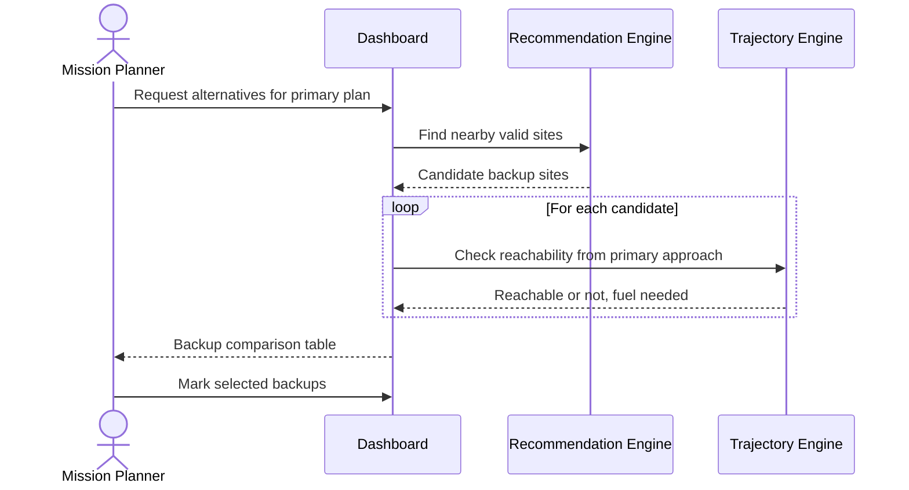

---

### S12 — Plan Post-Landing Exploration

**Release assignment — R8**

- **Actor:** P2
- **Goal:** Evaluate a landing site by how well it supports science operations after landing.
- **Preconditions:** A landing site and at least one science target are defined.

**Main flow**
1. The user selects science targets on the map.
2. The system computes the distance from the landing site to each target.
3. The system generates traversable rover or astronaut routes, avoiding steep slopes and hazards.
4. The system evaluates each route for sunlight and communication along the path.
5. The system shows a mission efficiency score for the site.

**Acceptance criteria**
- Routes avoid terrain above the slope limit.
- Each route shows its length, estimated duration, and shadowed segments.

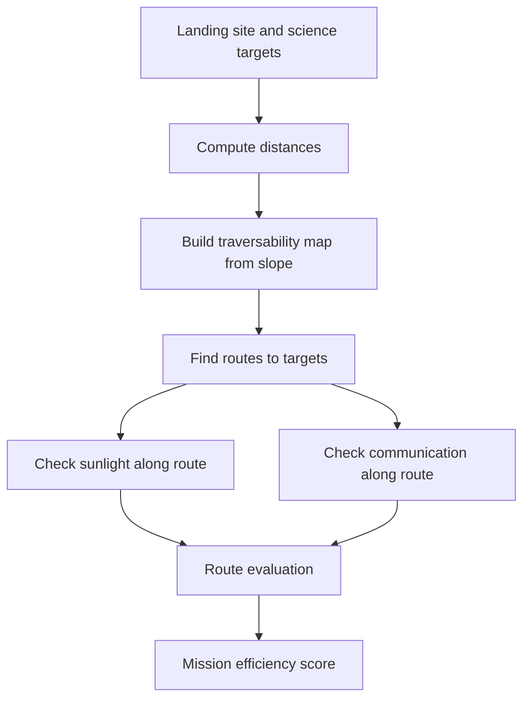

---

### S13 — Run a What-If Scenario

**Release assignment — MVP site/date subset; full scope in R9**

- **Actor:** P1
- **Goal:** See how changing mission parameters affects the plan.
- **Preconditions:** A baseline plan exists.

**Main flow**
1. The user duplicates the baseline plan as a new scenario.
2. The user changes one or more parameters: landing date, fuel capacity, vehicle mass, sensor or engine performance, or mission duration.
3. The system recomputes only the affected modules.
4. The system shows the baseline and the modified scenario side by side.

**Acceptance criteria**
- The baseline is never modified by a what-if run.
- The system clearly marks which results changed and by how much.

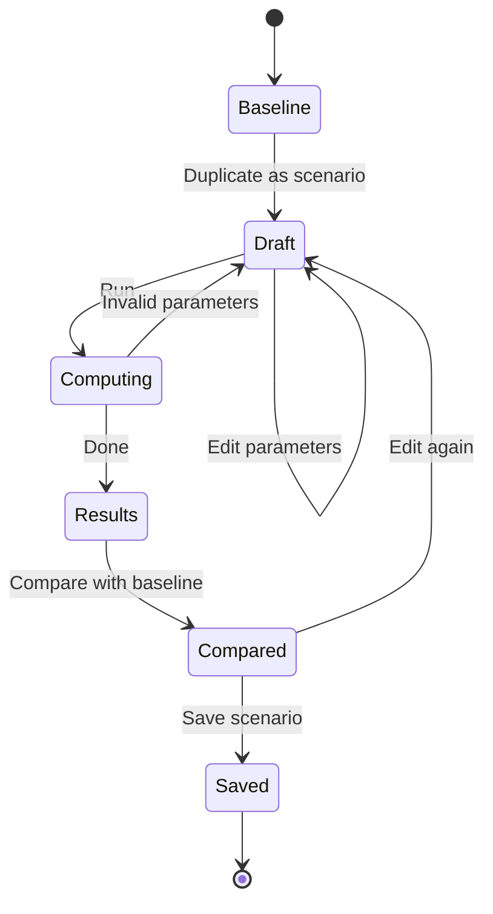

---

### S14 — Export and Share Results

**Release assignment — R1**

- **Actor:** P1, P3
- **Goal:** Use the analysis in reports or presentations.
- **Preconditions:** At least one analysis view is open.

**Main flow**
1. The user selects export.
2. The user chooses a format: shareable link, CSV time series, PNG charts, or a summary report.
3. The system generates the output.
4. A shareable link reopens the same view with the same parameters.

**Acceptance criteria**
- A shared link reproduces the same results.
- The CSV export includes units and the computation settings.

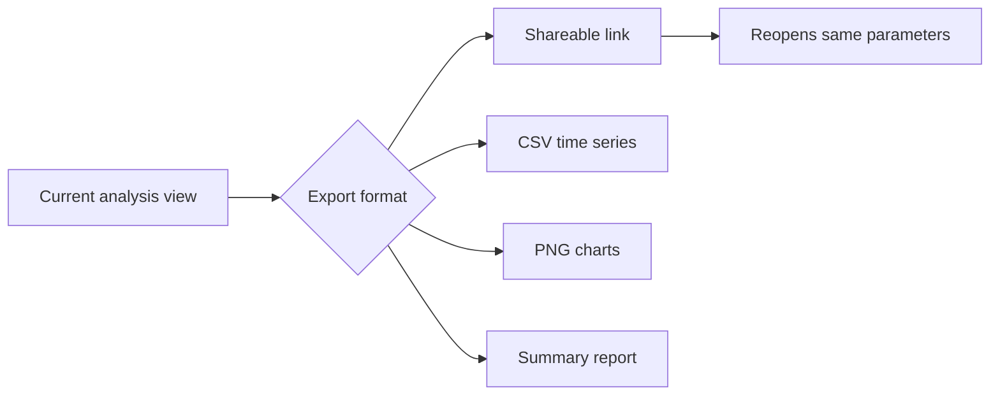

---

### S15 — Classroom Demonstration Mode

**R1 implementation note:** guided lessons, two-click start, speed/pause and explanation cards are delivered using real single-observer sky/horizon results (see [R1](release-r1.md)). The broader surface-wide moving-shadow and crater-rim/floor visualization in the design below is not implemented. Short-window results do not establish permanent shadow or illumination.

**Release assignment — MVP basic preset; full scope in R1**

- **Actor:** P3
- **Goal:** Explain why the lunar south pole has both near-permanent light and permanent shadow.
- **Preconditions:** Preset demonstration scenarios are available.

**Main flow**
1. The educator opens classroom mode.
2. The educator selects a preset, for example a crater rim compared with a crater floor.
3. The educator plays the time animation and the shadows move across the terrain.
4. Short explanation cards appear at key moments.
5. Technical panels are hidden by default.

**Acceptance criteria**
- A preset can be started in 2 clicks.
- The animation speed can be controlled and paused.

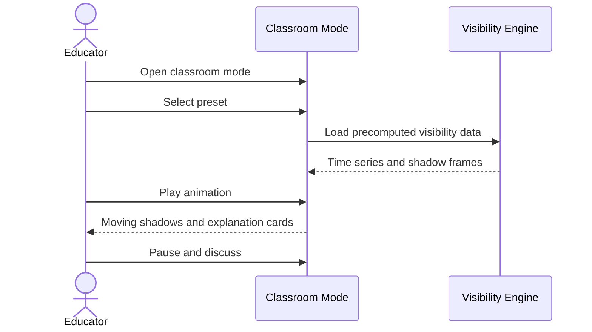

---

### S16 — Public Explore Mode

**Release assignment — MVP**

- **Actor:** P4
- **Goal:** Get simple answers about well-known candidate landing regions.
- **Preconditions:** Known candidate regions are preloaded.

**Main flow**
1. The user selects a known region from a list.
2. The system shows a "standing here" sky view with the horizon, the Sun, and Earth.
3. The system shows a plain-language summary, for example "This month, the Sun is visible X percent of the time."

**Acceptance criteria**
- No technical input is required.
- All summaries avoid unexplained jargon.

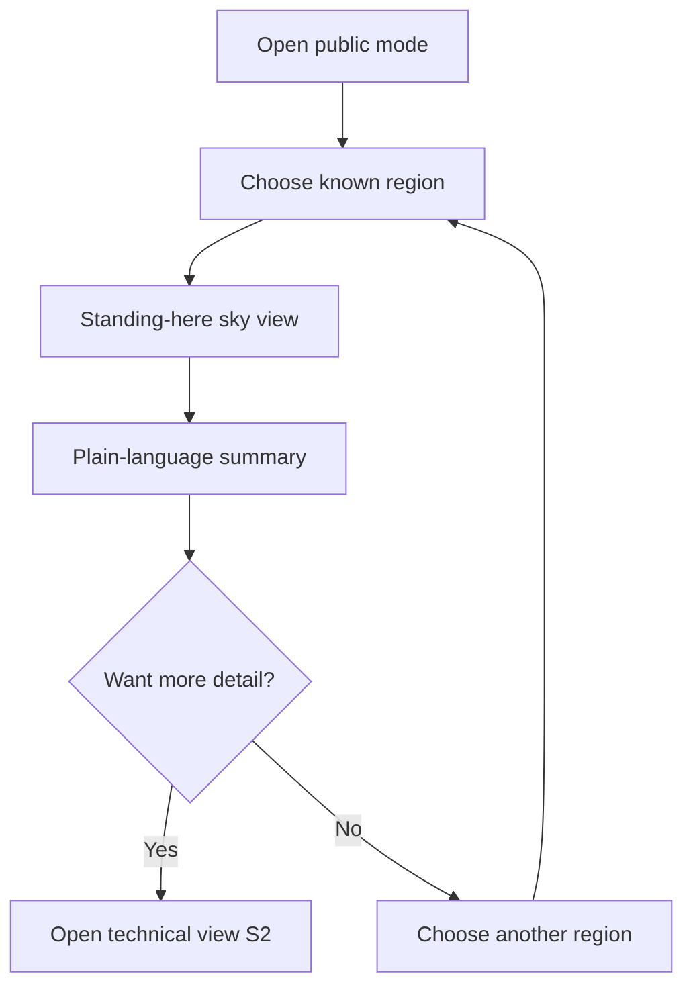

---

## 6. Extended Mission Planning Flow

This flow applies as R4–R9 are implemented. The MVP flow is select site/date → inspect visibility → compare a changed site/date.

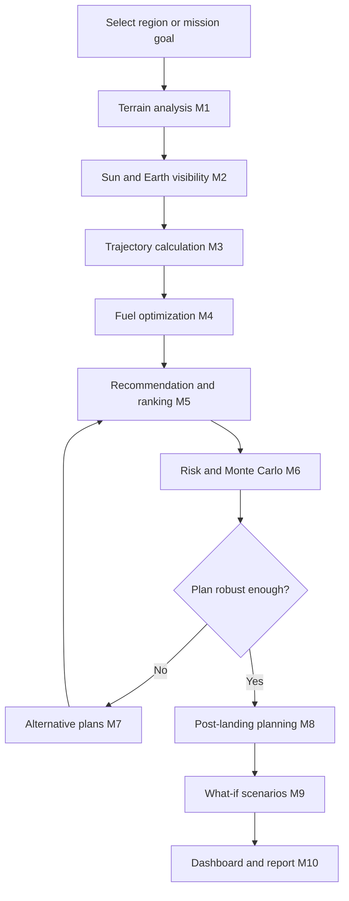

---

## 7. Data Sources and Assumptions

| Area | Source or assumption |
|------|----------------------|
| Terrain | NASA LRO LOLA digital elevation models for the south polar region |
| Sun and Earth positions | NASA/JPL Horizons observer ephemerides |
| Ground stations | Deep Space Network station coordinates |
| Spacecraft parameters | Documented reference models. Every assumption is shown to the user |
| Sensor and engine uncertainty | Assumed ranges, stated explicitly in the risk module |